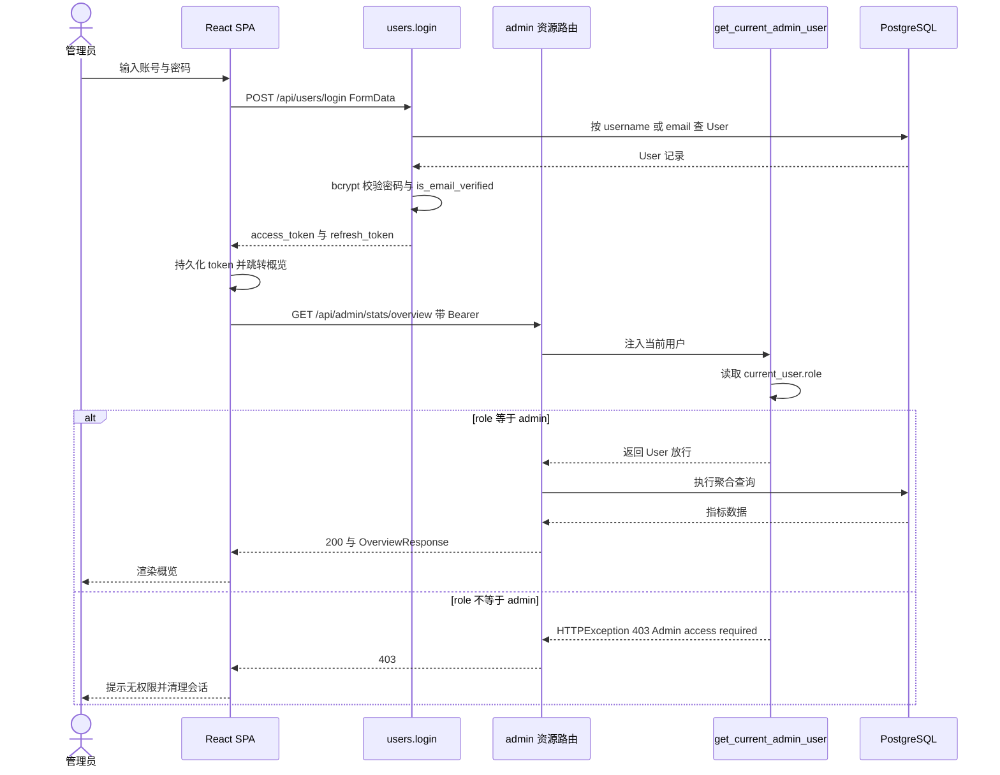
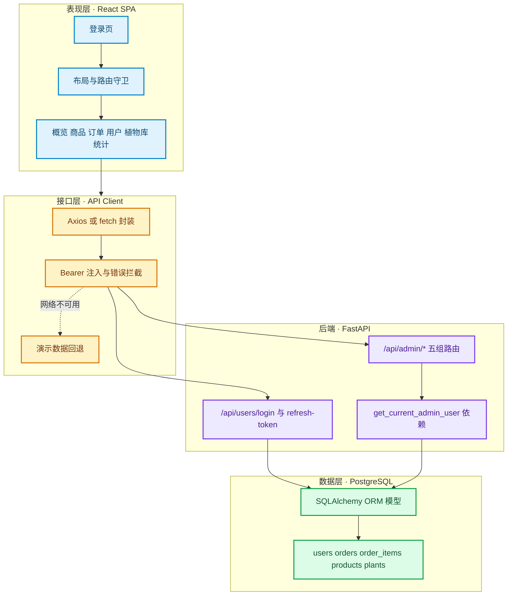
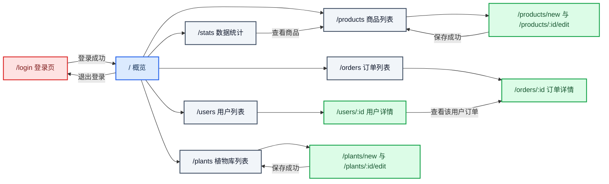
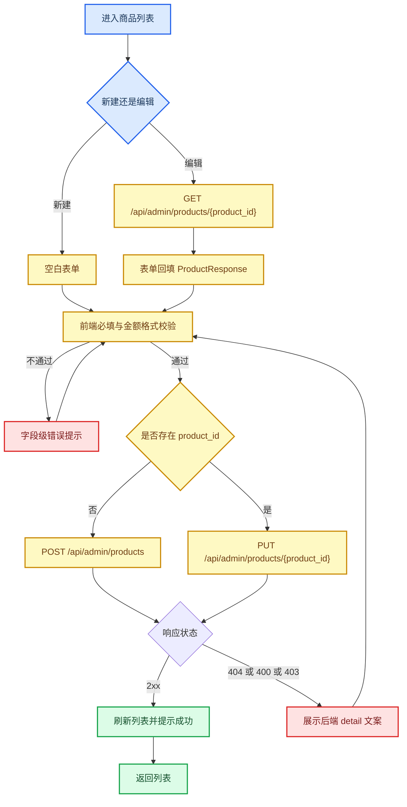
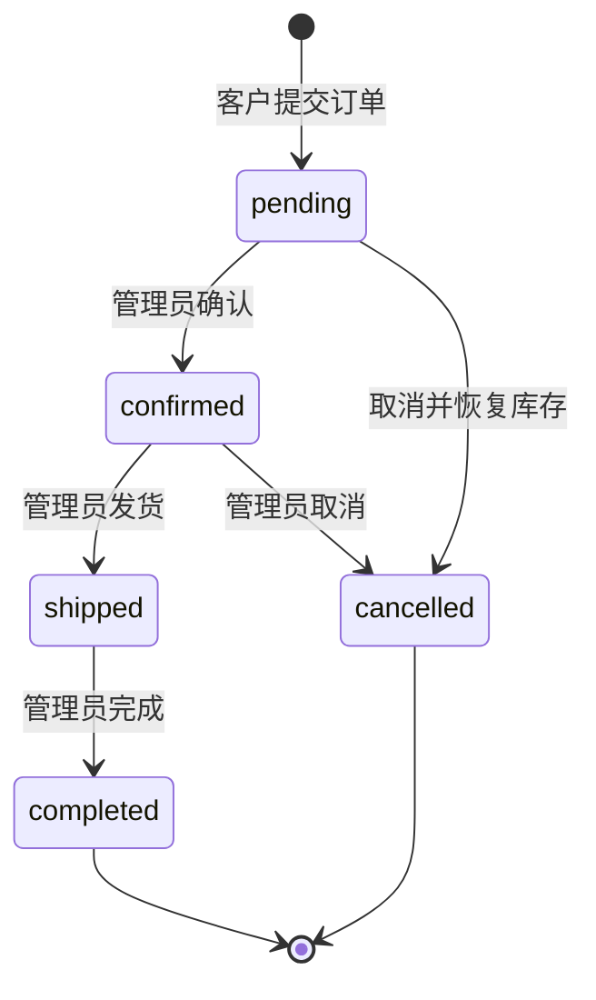
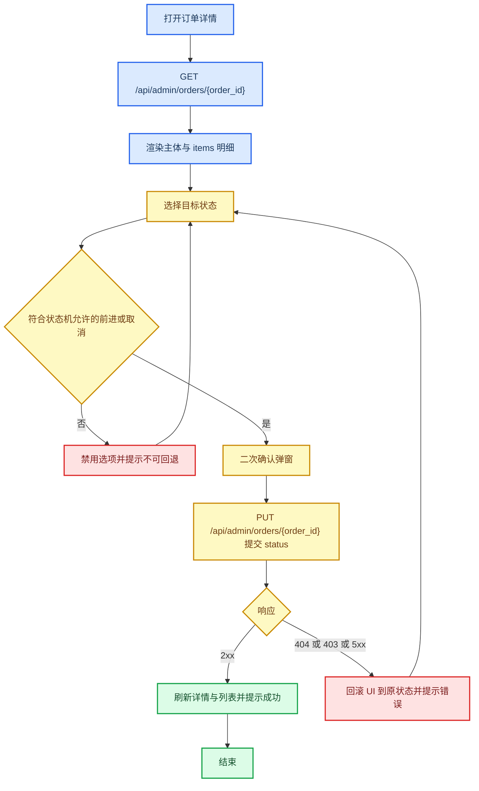
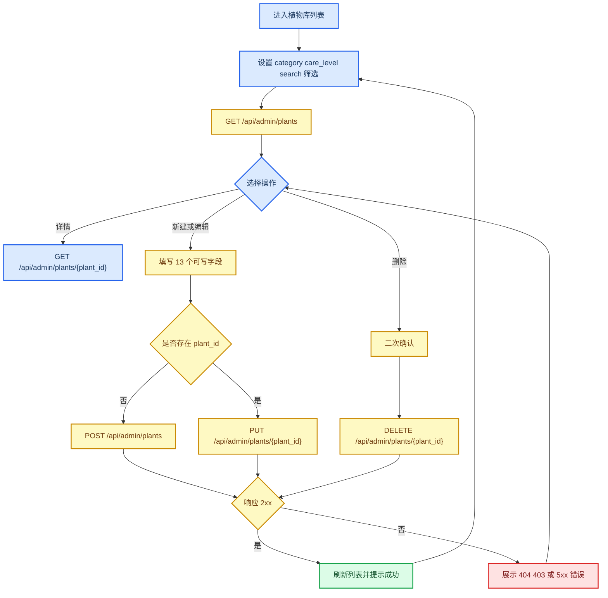
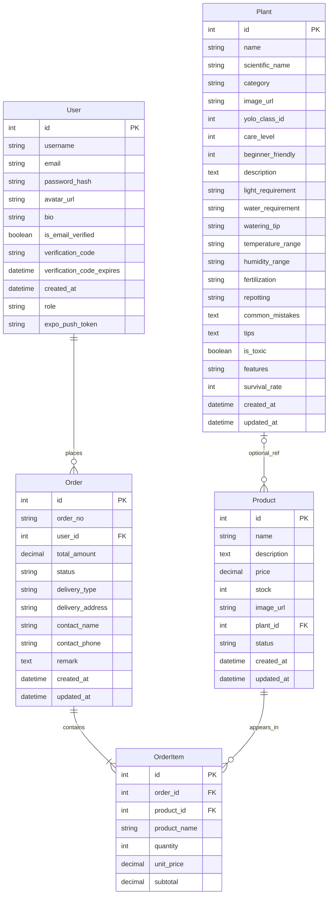
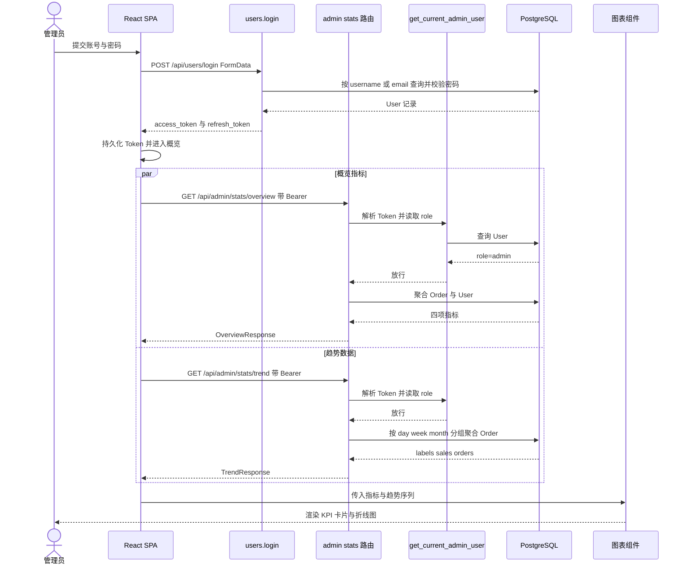
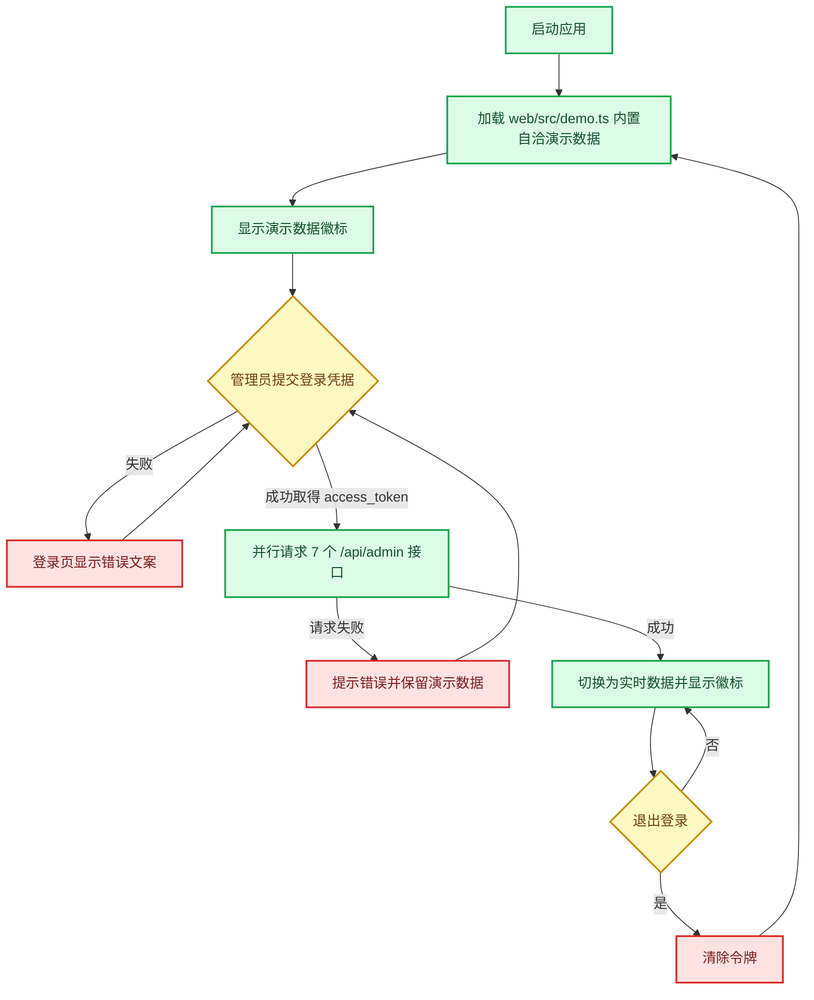

# 护花使者 · 管理后台功能分析文档

> 本文是「护花使者 / Flower Guardian」项目**管理后台（React SPA）重建**的功能分析交付物。所有接口、字段、状态码与业务规则均以 `backend/app/` 下的真实代码为唯一权威来源，并已在第 2～7 节及附录 D 中逐项复核。文档采用 Markdown + 内嵌 Mermaid 规范编写 [^7]。

| 项目 | 内容 |
| --- | --- |
| 文档名称 | 护花使者 · 管理后台功能分析文档 |
| 版本 | v1.0 |
| 日期 | 2026-11-15 |
| 作者 | 项目交付组（管理后台重建） |
| 状态 | 定稿 · 可直接交付 |
| 适用范围 | 仅管理后台 Web 端（React SPA，代码位于 `web/`）；不含微信小程序 `weixin/`、不含 React Native 消费者端 `APP/`；旧 Next.js 后台已删除并以 React SPA 重建；不含后端改造 |
| 权威代码基线 | `backend/app/api/router.py`、`backend/app/api/endpoints/`、`backend/app/schemas/`、`backend/app/models/`、`backend/app/core/security.py`、`backend/app/core/config.py` |
| 运行环境（前端） | Node v24.19.0、npm 12.0.2；配套交付 `web/` React SPA 源码与 `web/dist/` 静态构建产物 |

## 🎯 1 项目背景与目标

### 1.1 背景

护花使者是一套「植物养护 + AI 识别 + 电商」系统，原有四端：微信小程序 `weixin/`、React Native legacy `APP/`、FastAPI + PostgreSQL 后端 `backend/`、Next.js 管理后台 `web/`。本次工作中旧的 Next.js `web/` 已被删除，管理后台需要用 **React 从零重建**。

后端保持不动：`backend/app/main.py` 以 `app = FastAPI(title="护花使者 API", version="1.0.0")` 启动，通过 `app.include_router(api_router)` 挂载 `backend/app/api/router.py` 中统一注册的路由组，其中管理端路由为 `products_router`、`orders_admin_router`、`admin_users_router`、`admin_plants_router`、`admin_stats_router`。

### 1.2 目标

| 编号 | 目标 | 可度量结果 |
| --- | --- | --- |
| G-01 | 建立可用的管理员登录与会话 | 登录取得 JWT，所有管理端请求自动携带 `Authorization: Bearer` |
| G-02 | 覆盖七大功能模块 | 登录鉴权、概览、商品管理、订单管理、用户管理、植物库管理、数据统计 |
| G-03 | 与既有后端零改造对接 | 全部请求路径、参数、响应结构均以 `backend/app/` 代码为准，不新增后端接口 |
| G-04 | 支持经营闭环 | 商品上下架  -  订单状态推进  -  用户查询  -  植物库维护  -  数据复盘 |
| G-05 | 可演示、可验收 | 具备演示数据回退策略与可勾选验收清单 |

### 1.3 范围界定

| 维度 | 做什么 | 不做什么 |
| --- | --- | --- |
| 端 | **仅管理后台**这一端，React SPA，浏览器访问 | 不含 `weixin/` 小程序与 `APP/` 消费者端页面；不含任何移动端原生代码 |
| 技术栈 | React + Vite + TypeScript 单页应用，客户端路由 | 不复刻旧 Next.js 服务端渲染；不引入 SSR/BFF |
| 后端 | 直接调用现有 `/api/admin/*` 与 `/api/users/login` | 不修改 `backend/` 任何文件；不新增、不删除、不改名任何接口 |
| 数据 | 读取并展示真实业务数据；提供演示数据回退 | 不直接连接数据库，全部经 HTTP API |
| 履约 | 展示快递 `express` 与自提 `pickup` 两种 `delivery_type` | 不实现线上支付、购物车、优惠券、评价售后、物流追踪 |
| 部署 | 产出静态构建产物 | 不负责后端部署、数据库迁移、域名与网关配置 |

> 范围一句话：**这是一个只面向管理员、只读消费者侧数据但可写商品/订单/植物库的 React 单页应用**。

## 🔐 2 角色与权限

### 2.1 角色定义

| 角色 | 数据库标识 | 获取方式 | 可访问范围 |
| --- | --- | --- | --- |
| 管理员 | `users.role = "admin"` | **手动在库里**执行 `UPDATE users SET role='admin' WHERE ...`，注册接口 `POST /api/users/register` 只会写入默认 `role='user'` | 全部 `/api/admin/*` 接口 |
| 普通用户 | `users.role = "user"`（模型默认值） | 注册产生 | 消费者端接口；访问管理端接口一律 403 |

来自 `backend/app/models/user.py`：`role = Column(String(20), default="user")  # admin 或 user`。

### 2.2 鉴权链路

1. `POST /api/users/login` 使用 `OAuth2PasswordRequestForm`，即 **FormData** 的 `username` 与 `password` 字段 [^2]；后端同时以 username **或** email 匹配用户。
2. 密码用 `bcrypt.checkpw` 校验；通过后签发 JWT（`settings.ALGORITHM = "HS256"`，`sub = user.username`，`exp` 默认 30 分钟）[^1]。
3. 响应为 `Token`：`access_token`、`refresh_token`（7 天，带 `type="refresh"`）、`token_type="bearer"`。
4. 后续请求头携带 `Authorization: Bearer` 加 access_token [^9]。`get_current_user` 通过 `OAuth2PasswordBearer(tokenUrl="api/users/login", auto_error=False)` 解析并查库；失败抛 401。
5. 每个管理端路由再经依赖 `get_current_admin_user`：`if current_user.role != "admin": raise HTTPException(status_code=403, detail="Admin access required")` [^4]。

> **复核要点**：`get_current_admin_user` 并未集中在 `core/security.py`，而是在 `products.py`、`orders.py`、`admin_users.py`、`admin_plants.py`、`admin_stats.py` 五个文件中各自定义了一份同名同逻辑的函数，由 `Depends(get_current_admin_user)` 注入。



### 2.3 权限矩阵

| 接口组 | 未登录 | 已登录 role=user | 已登录 role=admin |
| --- | --- | --- | --- |
| `POST /api/users/login` | 允许 | 允许 | 允许 |
| `GET /api/users/me` | 401 | 允许 | 允许 |
| `/api/admin/products` | 401 | 403 | 允许 |
| `/api/admin/orders` | 401 | 403 | 允许 |
| `/api/admin/users` | 401 | 403 | 允许 |
| `/api/admin/plants` | 401 | 403 | 允许 |
| `/api/admin/stats` | 401 | 403 | 允许 |

> 前置条件补充：`login` 在校验密码后还会检查 `if not user.is_email_verified`，未验证邮箱返回 401 `"Email not verified. Please verify your email first."`。因此手动 `UPDATE users SET role='admin'` 时，该账号还需 `is_email_verified = true` 才能登录。

## 🏗️ 3 总体功能架构

系统分为四层。表现层为 React SPA；接口层是带 Bearer 注入与 401/403 统一处理的 API 客户端；后端层为 FastAPI 路由组与鉴权依赖；数据层为 SQLAlchemy ORM 映射的 PostgreSQL 表 [^3]。



### 3.1 分层职责

| 层 | 职责 | 关键约束 |
| --- | --- | --- |
| 表现层 | 路由、页面、表单、表格、图表、状态展示 | 不直连数据库；不自行伪造后端字段 |
| 接口层 | 统一 baseURL、注入 `Authorization`、错误码映射、演示数据回退 | 401 清会话并跳登录；403 显示无权限；5xx 显示错误态 |
| 后端层 | `api_router` 注册的路由、Pydantic 校验、SQLAlchemy 查询 | 全部管理端路由经 `get_current_admin_user` |
| 数据层 | `users / orders / order_items / products / plants` 等表 | `get_db()` 每请求一个 Session，`finally: db.close()` |

## 🗺️ 4 信息架构与页面清单

### 4.1 页面清单

| 路由 | 页面 | 一句话职责 | 主要操作 |
| --- | --- | --- | --- |
| `/login` | 登录页 | 以 FormData 提交管理员凭据并保存 JWT | 输入账号密码、提交、查看错误 |
| `/` | 概览 Overview | 展示经营核心指标与最近订单 | 查看 4 张 KPI 卡片、查看最近订单、跳转各模块 |
| `/products` | 商品列表 | 检索、筛选、分页查看商品 | 按 status/search 过滤、翻页、进入新建或编辑、删除 |
| `/products/new` | 商品新建 | 提交 `ProductCreate` | 填写名称/价格/库存/图片/关联植物/状态 |
| `/products/:id/edit` | 商品编辑 | 提交 `ProductUpdate`，含上下架 | 修改字段、切换 `status` 为 active 或 inactive |
| `/orders` | 订单列表 | 按状态与用户检索订单 | status/user_id 过滤、分页、进入详情 |
| `/orders/:id` | 订单详情 | 查看订单主体与订单项并推进状态 | 查看 `items`、修改 `status` 与其他可编辑字段 |
| `/users` | 用户列表 | 检索与分页查看注册用户 | search 过滤、翻页、进入详情 |
| `/users/:id` | 用户详情 | 查看用户资料与其订单摘要 | 查看资料、查看 `orders`、跳转订单详情 |
| `/plants` | 植物库列表 | 按分类与养护难度检索植物知识 | category/care_level/search 过滤、分页、新建、编辑、删除 |
| `/plants/new` 与 `/plants/:id/edit` | 植物表单 | 提交 `PlantCreate` 或 `PlantUpdate` | 填写植物名称与养护字段 |
| `/stats` | 数据统计 | 按日期范围与粒度展示销售趋势和商品排行 | 选 start_date/end_date、选 group_by、看趋势图与排行榜 |

> 页面路由为前端 SPA 约定，后端并不存在这些路径；`backend/app/main.py` 仅提供 `/`、`/health`、`/models/status` 与 `/api/*` 接口。本期实现改用 hash 路由与列表内弹窗完成下钻，详见 10.3。

### 4.2 页面跳转图



## 🧩 5 各模块功能详析

本章七个模块统一按「用例表  -  数据字段表  -  涉及 API 表  -  状态与边界  -  交互流程」组织。所有 `skip` 约束为 `ge=0`，所有 `limit` 约束为 `ge=1, le=100`（统计 `/products` 例外，见 5.7）。

### 5.1 登录鉴权

**用例表**

| 用例ID | 角色 | 前置条件 | 主流程 | 后置条件 |
| --- | --- | --- | --- | --- |
| UC-A-01 | 管理员 | 未登录；账号存在、`role='admin'`、`is_email_verified=true` | 输入 username（或 email）与 password  -  FormData POST `/api/users/login`  -  保存 Token  -  跳 `/` | 会话建立，后续请求自动带 Bearer |
| UC-A-02 | 管理员 | 未登录；密码错误或邮箱未验证 | 提交  -  401 | 停留登录页，展示 `Incorrect username/email or password` 或邮箱未验证提示 |
| UC-A-03 | 管理员 | access_token 已过期 | POST `/api/users/refresh-token` 携带 `refresh_token`  -  换取新 Token | 续期成功；失败则回落登录页 |
| UC-A-04 | 管理员 | 已登录 | 清除本地 token  -  跳 `/login` | 后续管理端请求返回 401 并被拦截 |
| UC-A-05 | 普通用户 | role=user | 登录成功但访问 `/api/admin/*` | 403 `Admin access required`，前端提示无权限 |

**数据字段表**

| 字段 | 位置 | 类型 | 说明与来源 |
| --- | --- | --- | --- |
| `username` | FormData | string | 登录标识；后端为 `(User.username == username_or_email) 或 (User.email == username_or_email)` |
| `password` | FormData | string | 明文提交，后端 `bcrypt.checkpw` 校验 `password_hash` |
| `access_token` | 响应 | string | JWT，HS256，`sub` 为 username，默认 30 分钟 |
| `refresh_token` | 响应 | string | 7 天，payload 含 `type="refresh"` |
| `token_type` | 响应 | string | 固定 `"bearer"` |
| `Authorization` | 请求头 | string | 取值为 Bearer 拼接 access_token |
| `role` | 库字段 | string | `admin` 方可访问管理端 |

**涉及的 API 表**

| 方法 | 路径 | 参数 | 响应 |
| --- | --- | --- | --- |
| POST | `/api/users/login` | FormData `username`、`password` | `Token`：access_token、refresh_token、token_type |
| POST | `/api/users/refresh-token` | JSON `refresh_token` | 新 `Token` |
| GET | `/api/users/me` | Bearer | `UserResponse`（id、username、email、avatar_url、bio、is_email_verified、role、created_at、expo_push_token） |

**状态与边界**

| 状态 | 处理 |
| --- | --- |
| 空 | 用户名或密码为空时前端必填校验，不发请求 |
| 零 | 库中无 admin 账号时返回 401，界面给出「请联系维护人员设置 role」提示 |
| 加载 | 提交中禁用按钮并显示加载态，防止重复提交 |
| 错误 | 401 凭据错误、401 邮箱未验证、403 非 admin、5xx、网络失败分别映射文案 |
| 权限 | 登录接口公开；管理端资源未登录 401、role=user 403 |

**交互流程**：登录时序图见 2.2 节。前端在获得 Token 后应立即调用 `GET /api/users/me` 确认 `role`，避免非管理员登录后进入空白壳页。

### 5.2 概览 Overview

**用例表**

| 用例ID | 角色 | 前置条件 | 主流程 | 后置条件 |
| --- | --- | --- | --- | --- |
| UC-O-01 | 管理员 | 已登录 | 进入 `/`  -  请求 `/api/admin/stats/overview` 与 `/api/admin/orders`  -  渲染 4 张 KPI 卡片与最近订单 | 概览可见 |
| UC-O-02 | 管理员 | 已登录 | 点击 KPI 卡片或侧栏入口 | 跳转到对应模块页面 |
| UC-O-03 | 管理员 | 数据为空 | 显示 0 与空态插画/文案，不报错 | 可继续操作 |

**数据字段表**

| 字段 | 类型 | 说明 |
| --- | --- | --- |
| `total_sales` | float | 日期范围内所有订单 `total_amount` 之和；**不按订单状态过滤** |
| `order_count` | int | 日期范围内订单条数 |
| `avg_order_value` | float | `total_sales / order_count`，无订单时为 0 |
| `user_count` | int | 按 `User.created_at` 落在日期范围内的**新增用户数**，非全量用户数 |
| `start_date` / `end_date` | string | 可选，ISO 格式；概览默认不传即全量 |

**涉及的 API 表**

| 方法 | 路径 | 参数 | 响应 |
| --- | --- | --- | --- |
| GET | `/api/admin/stats/overview` | `start_date`、`end_date` 可选 | `OverviewResponse` |
| GET | `/api/admin/orders` | `skip`、`limit=5` | `OrderListResponse`（最近订单） |
| GET | `/api/users/me` | Bearer | 当前管理员资料，用于页头展示 |

**状态与边界**

| 状态 | 处理 |
| --- | --- |
| 空 | 无订单时 `total_sales=0`、`order_count=0`、`avg_order_value=0`，展示「暂无订单」 |
| 零 | 四个指标各自独立为 0，不做除法兜底之外的特殊处理（后端已保证 `avg_order_value` 不为 NaN） |
| 加载 | 卡片骨架屏；最近订单表格骨架屏 |
| 错误 | 403/401 由拦截器统一处理；5xx 显示重试按钮 |
| 权限 | 全部请求需 role=admin |

**交互流程**：与 7 节时序图一致；概览为无日期筛选的轻量视图，深度分析交由 5.7 数据统计页。

### 5.3 商品管理

**用例表**

| 用例ID | 角色 | 前置条件 | 主流程 | 后置条件 |
| --- | --- | --- | --- | --- |
| UC-P-01 | 管理员 | 已登录 | 列表按 `status` 与 `search` 过滤，`skip/limit` 分页 | 展示 `total` 与 `items` |
| UC-P-02 | 管理员 | 已登录 | 新建表单提交 `ProductCreate`  -  POST `/api/admin/products` | 返回 `ProductResponse`，列表刷新 |
| UC-P-03 | 管理员 | 商品存在 | 编辑页 GET 详情回填  -  PUT `/api/admin/products/{product_id}` 提交 `ProductUpdate` | 字段更新；`updated_at` 自动刷新 |
| UC-P-04 | 管理员 | 商品存在 | 将 `status` 由 active 改为 inactive 或反向，复用 PUT | 商品上下架；公开接口 `/api/products` 仅返回 active |
| UC-P-05 | 管理员 | 商品存在且无订单项引用 | DELETE `/api/admin/products/{product_id}` | 返回 `{"message":"Product deleted successfully"}` |
| UC-P-06 | 管理员 | 商品不存在 | GET/PUT/DELETE | 404 `"Product not found"` |

**数据字段表**

| 字段 | 类型 | 必填 | 说明 |
| --- | --- | --- | --- |
| `id` | int | 响应 | 主键 |
| `name` | string(100) | 创建必填 | 商品名；`search` 用 `Product.name.contains(search)` 模糊匹配 |
| `description` | text | 否 | 描述 |
| `price` | Decimal / Numeric(10,2) | 创建必填 | 两位小数金额 [^8] |
| `stock` | int | 否，默认 0 | 库存 |
| `image_url` | string(500) | 否 | 图片 URL，前端只存字符串不上传文件 |
| `plant_id` | int FK plants.id | 否 | 关联植物库，可为空 |
| `status` | string(20) | 否，默认 `active` | 约定值 `active` / `inactive`，无数据库枚举约束 |
| `created_at` / `updated_at` | datetime | 响应 | `updated_at` 带 `onupdate=datetime.utcnow` |

**涉及的 API 表**

| 方法 | 路径 | 参数 | 响应 |
| --- | --- | --- | --- |
| GET | `/api/admin/products` | `status`、`search`、`skip`、`limit` | `{total, items[ProductResponse]}` |
| POST | `/api/admin/products` | JSON `ProductCreate` | `ProductResponse` |
| GET | `/api/admin/products/{product_id}` | 路径参数 | `ProductResponse` |
| PUT | `/api/admin/products/{product_id}` | JSON `ProductUpdate`（仅提交变更字段） | `ProductResponse` |
| DELETE | `/api/admin/products/{product_id}` | 路径参数 | `{"message":"Product deleted successfully"}` |

**状态与边界**

| 状态 | 处理 |
| --- | --- |
| 空 | `total=0` 时展示空态与「新建商品」入口；搜索无结果时保留筛选条件并提供清除 |
| 零 | `stock=0` 显示「缺货」标记；`price` 允许 0 但前端应二次确认 |
| 加载 | 表格骨架屏；提交中禁用保存按钮 |
| 错误 | 404 目标不存在、400 Pydantic 校验失败（如 price 非法）、403 无权限、5xx；DELETE 因 `order_items.product_id` 外键引用可能失败，前端需提示「该商品已有订单记录」 |
| 权限 | 全部需 role=admin；公开接口 `/api/products` 无需鉴权但不属管理后台调用范围 |

**交互流程**



### 5.4 订单管理

**用例表**

| 用例ID | 角色 | 前置条件 | 主流程 | 后置条件 |
| --- | --- | --- | --- | --- |
| UC-OR-01 | 管理员 | 已登录 | 列表按 `status` 与 `user_id` 过滤，按 `created_at.desc()` 排序分页 | 展示订单列表与 `total` |
| UC-OR-02 | 管理员 | 订单存在 | GET `/api/admin/orders/{order_id}`  -  展示主体与 `items` | 详情页可见 |
| UC-OR-03 | 管理员 | 订单存在 | 选择目标状态  -  PUT `/api/admin/orders/{order_id}` 提交 `OrderUpdate` | 状态推进；`updated_at` 刷新 |
| UC-OR-04 | 管理员 | 从用户详情跳转 | 以 `user_id` 过滤订单列表 | 仅显示该用户订单 |
| UC-OR-05 | 管理员 | 订单不存在 | GET/PUT | 404 `"Order not found"` |

**数据字段表**

| 字段 | 类型 | 说明 |
| --- | --- | --- |
| `id` / `order_no` | int / string(50) | 主键与唯一订单号；消费者端格式为 `ORD` 加时间戳加 6 位大写十六进制 |
| `user_id` | int FK users.id | 下单用户 |
| `total_amount` | Numeric(10,2) | 订单总额，由各订单项 `subtotal` 累加 |
| `status` | string(20) | `pending / confirmed / shipped / completed / cancelled`，模型注释约定，无 DB 枚举约束 |
| `delivery_type` | string(20) | `express`（快递）或 `pickup`（自提） |
| `delivery_address` | string(255) | 自提时可为空 |
| `contact_name` / `contact_phone` | string(50) / string(20) | 联系人信息 |
| `remark` | text | 备注 |
| `created_at` / `updated_at` | datetime | 时间戳 |
| `items[].id` / `product_id` / `product_name` | int / int / string | 订单项标识与冗余商品名 |
| `items[].quantity` / `unit_price` / `subtotal` | int / Numeric(10,2) / Numeric(10,2) | 数量、成交单价、小计；`subtotal = unit_price × quantity` |

**涉及的 API 表**

| 方法 | 路径 | 参数 | 响应 |
| --- | --- | --- | --- |
| GET | `/api/admin/orders` | `status`、`user_id`、`skip`、`limit` | `OrderListResponse {total, items[OrderResponse]}` |
| GET | `/api/admin/orders/{order_id}` | 路径参数 | `OrderResponse`（含 `items`） |
| PUT | `/api/admin/orders/{order_id}` | JSON `OrderUpdate` | `OrderResponse` |

> `OrderUpdate` 的可写字段为 `status`、`delivery_type`、`delivery_address`、`contact_name`、`contact_phone`、`remark`，并非只能改状态。后端使用 `model_dump(exclude_unset=True)` 逐字段 `setattr`，不做任何状态流转校验。

**订单状态机**



> 上图是**前端应实现的业务约定**。后端 `PUT /api/admin/orders/{order_id}` 对 `status` 没有合法性或流转顺序校验（`OrderUpdate.status` 为普通 `Optional[str]`），因此必须由管理后台在 UI 层限制可选目标状态，避免出现 `completed  -  pending` 之类的倒退。消费者端 `POST /api/orders/{order_id}/cancel` 则明确只允许 `pending` 取消，且会回补库存。

**状态与边界**

| 状态 | 处理 |
| --- | --- |
| 空 | `total=0` 展示空态；筛选无结果提供「清除筛选」 |
| 零 | `items` 为空数组时展示「无订单项」；`total_amount` 与明细求和不一致时给出数据异常提示 |
| 加载 | 列表与详情骨架屏；状态提交中锁定下拉 |
| 错误 | 404 订单不存在、400 校验失败、403 无权限、5xx；非法目标状态由前端拦截 |
| 权限 | 全部需 role=admin；客户取消接口不属管理后台调用范围 |

**交互流程**



### 5.5 用户管理

**用例表**

| 用例ID | 角色 | 前置条件 | 主流程 | 后置条件 |
| --- | --- | --- | --- | --- |
| UC-U-01 | 管理员 | 已登录 | 列表按 `search` 过滤 username 或 email，分页 | 展示 `total` 与用户项 |
| UC-U-02 | 管理员 | 用户存在 | GET `/api/admin/users/{user_id}`  -  展示资料与 `orders`（按 `created_at.desc()`） | 详情页可见 |
| UC-U-03 | 管理员 | 用户存在 | GET `/api/admin/users/{user_id}/orders` 单独分页拉取订单 | 订单历史可分页 |
| UC-U-04 | 管理员 | 用户不存在 | GET 详情 | 404 `"User not found"` |
| UC-U-05 | 管理员 | 用户详情中点击某订单 | 跳转 `/orders/:id` | 复用订单详情 |

**数据字段表**

| 字段 | 类型 | 说明 |
| --- | --- | --- |
| `id` / `username` / `email` | int / string(50) / string(100) | 基本信息；`search` 用 `contains` 双字段模糊匹配 |
| `password_hash` | string(255) | 库中敏感列，管理后台**不展示** |
| `avatar_url` / `bio` | string(500) / string(500) | 头像与简介 |
| `is_email_verified` | boolean | 影响消费者端能否登录；管理端详情响应**不返回**该字段 |
| `role` | string(20) | `user` 或 `admin` |
| `expo_push_token` | string(500) | 推送令牌；管理端详情响应**不返回** |
| `created_at` | datetime | 注册时间；统计 `user_count` 按此字段过滤 |
| `orders` | list | 仅详情响应包含；`UserWithOrdersResponse.orders: list = []` |

**涉及的 API 表**

| 方法 | 路径 | 参数 | 响应 |
| --- | --- | --- | --- |
| GET | `/api/admin/users` | `search`、`skip`、`limit` | `UserListResponse {total, items}` |
| GET | `/api/admin/users/{user_id}` | 路径参数 | `UserWithOrdersResponse`：id、username、email、avatar_url、bio、role、created_at、orders |
| GET | `/api/admin/users/{user_id}/orders` | `skip`、`limit` | `{total, items}`，按 `created_at.desc()` 排序 |

**状态与边界**

| 状态 | 处理 |
| --- | --- |
| 空 | `total=0` 展示空态；用户无订单时 `orders=[]` 展示「暂无订单」 |
| 零 | `total=0` 的订单历史单独展示空态，不影响用户资料区 |
| 加载 | 列表与详情骨架屏；订单历史独立加载态 |
| 错误 | 404 `User not found`、403 无权限、5xx |
| 权限 | 全部需 role=admin；本模块**只读**，无创建/编辑/删除/改角色接口 |

> 复核提示：`UserListResponse.items` 与 `PlantListResponse.items` 均声明为**无元素类型的** `list`，即未用 `UserResponse` 做逐项校验；前端应按字段白名单取值渲染，不依赖也不回显 `password_hash`、`verification_code`、`expo_push_token` 等敏感列。

**交互流程**：列表  -  详情为单次下钻；详情内 `orders` 与独立订单历史接口二选一使用，需要分页时用后者。

### 5.6 植物库管理

**用例表**

| 用例ID | 角色 | 前置条件 | 主流程 | 后置条件 |
| --- | --- | --- | --- | --- |
| UC-PL-01 | 管理员 | 已登录 | 列表按 `category` 精确匹配、`care_level` 精确匹配、`search` 名称模糊匹配，分页 | 展示植物列表与 `total` |
| UC-PL-02 | 管理员 | 植物存在 | GET `/api/admin/plants/{plant_id}` 查看详情 | 详情可见 |
| UC-PL-03 | 管理员 | 已登录 | 新建表单提交 `PlantCreate`  -  POST | 新植物入库 |
| UC-PL-04 | 管理员 | 植物存在 | PUT `/api/admin/plants/{plant_id}` 提交 `PlantUpdate` | 字段更新 |
| UC-PL-05 | 管理员 | 植物存在且无商品引用 | DELETE | `{"message":"Plant deleted successfully"}` |
| UC-PL-06 | 管理员 | 植物不存在 | GET/PUT/DELETE | 404 `"Plant not found"` |

**数据字段表**

`Plant` 模型共 21 个业务字段，但管理端 `PlantCreate` / `PlantUpdate`（定义于 `admin_plants.py`，非 `schemas/plant.py`）**只暴露 13 个可写字段**：

| 字段 | 类型 | 管理端可写 | 说明 |
| --- | --- | --- | --- |
| `name` | string(100) | 是，创建必填 | 植物名，`search` 模糊匹配 |
| `scientific_name` | string(150) | 是 | 学名 |
| `category` | string(50) | 是 | 分类，列表精确过滤 |
| `care_level` | int | 是，默认 1 | 养护难度，列表精确过滤；`if care_level:` 使 0 被忽略 |
| `description` | text | 是 | 描述 |
| `light_requirement` / `water_requirement` | string(20) | 是 | 光照/浇水需求 |
| `temperature_range` / `humidity_range` | string(50) | 是 | 温湿度范围 |
| `fertilization` / `repotting` | string(100) | 是 | 施肥/换盆 |
| `common_mistakes` / `tips` | text | 是 | 常见误区与技巧 |
| `image_url` / `yolo_class_id` / `beginner_friendly` / `watering_tip` / `is_toxic` / `features` / `survival_rate` | 混合 | **否** | 仅存在于模型与 `schemas/plant.py`，管理端 POST/PUT 不接受 |
| `created_at` / `updated_at` | datetime | 否 | 自动维护 |

> 管理端 `PlantResponse`（定义于 `admin_plants.py`）只返回 `id, name, scientific_name, category, care_level, description` 六个字段，与 `schemas/plant.py` 中完整的 `PlantResponse` 不是同一个类。表单若需展示其余字段，须以字段白名单方式处理缺失值。

**涉及的 API 表**

| 方法 | 路径 | 参数 | 响应 |
| --- | --- | --- | --- |
| GET | `/api/admin/plants` | `category`、`care_level`、`search`、`skip`、`limit` | `{total, items}` |
| POST | `/api/admin/plants` | JSON `PlantCreate` | 精简 `PlantResponse` |
| GET | `/api/admin/plants/{plant_id}` | 路径参数 | 精简 `PlantResponse` |
| PUT | `/api/admin/plants/{plant_id}` | JSON `PlantUpdate` | 精简 `PlantResponse` |
| DELETE | `/api/admin/plants/{plant_id}` | 路径参数 | `{"message":"Plant deleted successfully"}` |

**状态与边界**

| 状态 | 处理 |
| --- | --- |
| 空 | `total=0` 展示空态；筛选无结果提供清除 |
| 零 | `care_level` 传 0 会被后端 `if care_level:` 跳过，前端不要提供 0 选项 |
| 加载 | 表格与表单骨架屏 |
| 错误 | 404 `Plant not found`、400 校验失败、403 无权限、5xx；被 `products.plant_id` 引用时删除可能失败 |
| 权限 | 全部需 role=admin |

**交互流程**



### 5.7 数据统计

**用例表**

| 用例ID | 角色 | 前置条件 | 主流程 | 后置条件 |
| --- | --- | --- | --- | --- |
| UC-S-01 | 管理员 | 已登录 | 选择 `start_date` / `end_date` 与 `group_by`  -  请求三个统计接口  -  渲染 KPI、趋势图、商品排行 | 报表可见 |
| UC-S-02 | 管理员 | 已登录 | 切换 `group_by` 为 day/week/month | 趋势图按新粒度重绘 |
| UC-S-03 | 管理员 | 已登录 | 调整 `limit` 查看商品排行长度 | 排行 1～50 条 |
| UC-S-04 | 管理员 | 区间内无订单 | 接收 0 与空数组 | 展示空态而非报错 |

**数据字段表**

| 字段 | 类型 | 说明 |
| --- | --- | --- |
| `start_date` / `end_date` | string | 可选；后端用 `datetime.fromisoformat(start_date)` 解析，前端必须传合法 ISO 字符串 |
| `group_by` | string | `Query("day", pattern="^(day|week|month)$")`；day 键为 `%Y-%m-%d`，week 为 `%Y-W%W`，month 为 `%Y-%m` |
| `labels` / `sales` / `orders` | list | 趋势三等长数组，按 key 升序 |
| `total_sales` / `order_count` / `avg_order_value` / `user_count` | float / int / float / int | 概览四指标 |
| `limit` | int | 仅 `/products` 使用，默认 **10** 而非 1，范围 `ge=1, le=50` |
| `items[].product_id` / `product_name` / `sales_count` / `sales_amount` | int / string / int / float | 商品排行；按 `sum(quantity) desc` 排序，按 `product_id + product_name` 分组 |

**涉及的 API 表**

| 方法 | 路径 | 参数 | 响应 |
| --- | --- | --- | --- |
| GET | `/api/admin/stats/overview` | `start_date`、`end_date` | `OverviewResponse` |
| GET | `/api/admin/stats/trend` | `start_date`、`end_date`、`group_by` | `TrendResponse {labels, sales, orders}` |
| GET | `/api/admin/stats/products` | `start_date`、`end_date`、`limit` | `ProductsResponse {items}` |

**统计口径差异（重要）**

| 接口 | 订单状态过滤 | 聚合对象 | 用户口径 |
| --- | --- | --- | --- |
| `/overview` | **无**，含 `cancelled` 在内全部订单 | `Order.total_amount` 求和 | `User.created_at` 在区间内的新增用户数 |
| `/trend` | **无**，含 `cancelled` 在内全部订单 | 同上，按时间分组 | 不涉及 |
| `/products` | **仅** `Order.status.in_(["completed", "shipped"])` | `OrderItem.quantity` 与 `OrderItem.subtotal` | 不涉及 |

因此同一时间区间内，`overview.total_sales` 与商品排行 `sales_amount` 之和**通常不相等**，界面必须分别标注口径，避免误读。

**状态与边界**

| 状态 | 处理 |
| --- | --- |
| 空 | 三个接口均返回 0 或空数组；趋势图与排行展示空态 |
| 零 | `order_count=0` 时后端已令 `avg_order_value=0`，前端不做除法 |
| 加载 | KPI 骨架屏、图表占位、排行骨架屏；三请求并行发起 |
| 错误 | `group_by` 非法触发 422；日期格式非法会在 `datetime.fromisoformat` 抛 ValueError 导致 5xx，前端须用日期选择器生成 ISO 串并做格式校验；403/401 由拦截器处理 |
| 权限 | 全部需 role=admin |

**交互流程**

```mermaid
flowchart LR
    accTitle: 数据统计筛选与渲染流程
    accDescr: 管理员设定日期范围与分组粒度后，前端并行请求概览、趋势与商品排行三个接口，聚合结果分别渲染指标卡、折线图与排行榜。

    s1["选择日期范围与 group_by"] --> s2["生成 ISO 日期串并校验格式"]
    s2 --> s3["并行发起三个 GET 请求"]
    s3 --> s4["GET /api/admin/stats/overview"]
    s3 --> s5["GET /api/admin/stats/trend"]
    s3 --> s6["GET /api/admin/stats/products"]
    s4 --> s7["渲染 KPI 指标卡"]
    s5 --> s8["渲染销售趋势折线图"]
    s6 --> s9["渲染商品排行榜"]
    s7 --> s10["标注统计口径说明"]
    s8 --> s10
    s9 --> s10
    s10 --> s11["切换条件重新请求"]
    s11 --> s1

    classDef input fill:#dbeafe,stroke:#2563eb,stroke-width:2px,color:#1e3a5f
    classDef call fill:#fef9c3,stroke:#ca8a04,stroke-width:2px,color:#713f12
    classDef view fill:#dcfce7,stroke:#16a34a,stroke-width:2px,color:#14532d
    class s1,s2,s11 input
    class s3,s4,s5,s6 call
    class s7,s8,s9,s10 view
```

## 💾 6 数据模型与实体关系

实体来自 `backend/app/models/user.py`、`order.py`、`product.py`、`plant.py`；金额列为 `Numeric(10, 2)`，可精确表示两位小数 [^8]。



| 关系标签 | 含义 | 代码依据 |
| --- | --- | --- |
| `places` | 一个 User 可有零或多笔 Order；每笔 Order 必属一个 User | `Order.user_id = Column(Integer, ForeignKey("users.id"), nullable=False)` |
| `contains` | 一笔 Order 有一或多条 OrderItem；`cascade="all, delete-orphan"` | `Order.items = relationship("OrderItem", ..., cascade="all, delete-orphan")` |
| `appears_in` | 一个 Product 可出现在零或多条 OrderItem | `OrderItem.product_id = Column(Integer, ForeignKey("products.id"), nullable=False)` |
| `optional_ref` | 一个 Product 可关联零或一个 Plant；一个 Plant 可被零或多个 Product 关联 | `Product.plant_id = Column(Integer, ForeignKey("plants.id"), nullable=True)` |

> 图中不含 `user_plants`、`reminders`、`diaries` 等消费者端养护实体：它们由 `backend/app/models/plant.py` 等文件定义，但本次管理后台不提供对应页面，故不纳入本图与字段字典。

## 🔄 7 数据流与接口时序

下图刻画管理员登录  -  携带 token 并行拉取 `/api/admin/stats/overview` 与 `/trend`  -  渲染图表的完整链路，与 5.2、5.7 节呼应。



### 7.1 关键时序约束

| 约束 | 说明 |
| --- | --- |
| Token 注入时机 | 登录成功后才注入 `Authorization`；登录请求本身不带 token |
| 并发 | `overview` 与 `trend` 无依赖，应并行发起以降低首屏耗时 |
| 鉴权次数 | 每个管理端请求都会各自执行一次 `get_current_user` 与 `get_current_admin_user`，前端不做鉴权缓存假设 |
| 会话过期 | access_token 默认 30 分钟；收到 401 时先用 `refresh-token` 续期一次，再失败才跳登录 |
| 日期参数 | 传给三个统计接口的 `start_date` / `end_date` 须为 `datetime.fromisoformat` 可解析的 ISO 字符串 |

## 🛡️ 8 非功能性需求

### 8.1 鉴权与安全

| 项 | 要求 | 代码依据 |
| --- | --- | --- |
| 口令存储 | 前端不保存明文密码；只存 `access_token` 与 `refresh_token` | `bcrypt` 哈希存于 `users.password_hash` |
| 令牌算法 | HS256，`sub` 为 username，access 30 分钟 / refresh 7 天 | `core/config.py`：`ALGORITHM="HS256"`、`ACCESS_TOKEN_EXPIRE_MINUTES=30`、`REFRESH_TOKEN_EXPIRE_DAYS=7` |
| 密钥 | 生产环境必须覆盖默认 `SECRET_KEY="secret-key-change-in-production"` | `core/config.py` |
| 请求头 | 统一 `Authorization: Bearer` 加 access_token [^9] | `OAuth2PasswordBearer` 与 `get_token_from_header` |
| 越权 | 401 清会话跳登录；403 显示无权限；不隐藏 403 文案 | `HTTPException(403, "Admin access required")` [^4] |
| 敏感字段 | 不渲染 `password_hash`、`verification_code`、`expo_push_token` | `UserListResponse.items: list` 未做字段白名单 |
| CORS | 后端 `allow_origins=["*"]` 且 `allow_credentials=False`；SPA 应配置明确的 `VITE_API_BASE` 而非依赖通配 | `backend/app/main.py`、`web/src/api.ts:3` |

### 8.2 错误处理

| HTTP | 典型 detail | 前端动作 |
| --- | --- | --- |
| 401 | `Could not validate credentials` / `Incorrect username/email or password` / `Email not verified...` | 尝试一次 refresh，失败清会话跳 `/login`；登录页直显文案 |
| 403 | `Admin access required` | 显示「当前账号非管理员」并提供退出 |
| 404 | `Product not found` / `Order not found` / `User not found` / `Plant not found` | 返回列表并提示记录已不存在 |
| 422 | 请求参数校验失败（如 `group_by` 不合法、limit 越界） | 表单或筛选器内联提示 |
| 5xx | 服务异常、日期格式导致的 ValueError | 通用错误态 + 重试按钮，保留筛选条件 |

### 8.3 响应式

| 断点 | 布局策略 |
| --- | --- |
| 1440px | 固定侧栏 + 主区双列；表格完整展示所有列；图表满宽 |
| 768px | 侧栏收起为图标或抽屉；表格横向滚动或隐藏次要列；KPI 卡片两列 |
| 390px | 侧栏变底部导航或抽屉；表格转卡片列表；KPI 卡片单列；图表高度压缩；表单单列 |

### 8.4 可访问性

遵循 WCAG 2.2 [^5]：所有 Mermaid 图均带 `accTitle` 与 `accDescr`；表单控件有关联 label；状态不只靠颜色区分（附文字与图标语义）；图表提供等价数据表格；焦点可见、支持键盘操作；文本对比度达标。

### 8.5 性能

| 项 | 策略 |
| --- | --- |
| 分页 | 列表一律使用 `skip/limit`，`limit` 上限 100，禁止一次拉取全表 |
| 搜索 | 输入防抖后再请求；保留 `total` 驱动分页器 |
| 并发 | 概览与统计页并行发起互相独立的 GET |
| 图表 | 仅在数据到达后初始化；`group_by` 变化时复用容器 |
| 缓存 | 对短期不变的字典类数据做内存缓存，但不对权限结果做缓存假设 |

### 8.6 演示数据回退策略说明

管理后台需可在后端不可用时演示。策略如下，**不改变后端行为**；本期实现的实际差异见 10.3：

1. 通过环境变量 `VITE_API_BASE` 配置后端地址（默认 `http://localhost:8000`）；首次进入即使用内置演示数据，登录成功后才切换到真实接口。
2. 演示数据内置于 `web/src/demo.ts`：12 个商品、10 个植物、8 位用户与最近 14 天订单；订单金额按 `subtotal = unit_price × quantity` 与 `total_amount = sum(subtotal)` 严格自洽，`/overview` 与 `trend` 计入全部状态、`/products` 仅计 completed 与 shipped，复现后端统计口径。
3. 侧栏持续显示数据源徽标（「演示数据」或「实时接口」）；演示态写操作仅修改浏览器内存、不落库，退出登录后重置。
4. 登录页成功取得 `access_token` 后并行拉取 7 个管理端接口切换为真实数据；退出登录回到演示数据。

自洽算法示例（三笔订单，为设计示例数值，非实现数据）：

| 订单号 | 状态 | 履约 | 商品 | 数量 | 单价 | 小计 | 订单总额 |
| --- | --- | --- | --- | --- | --- | --- | --- |
| `ORD20261115093000A1B2C3` | completed | express | 陶瓷北欧风花盆 | 2 | 29.90 | 59.80 | 79.70 |
| 同上 | completed | express | 有机花肥500g | 1 | 19.90 | 19.90 | 计入上行 |
| `ORD20261114150000D4E5F6` | shipped | pickup | 发财树盆栽 | 1 | 88.00 | 88.00 | 88.00 |
| `ORD20261113103000G7H8I9` | pending | express | 室内绿萝盆栽 | 3 | 35.00 | 105.00 | 105.00 |

由此推导：`overview.total_sales = 79.70 + 88.00 + 105.00 = 272.70`、`order_count = 3`、`avg_order_value = 272.70 / 3 = 90.90`；`trend` 按 day 为 `labels=["2026-11-13","2026-11-14","2026-11-15"]`、`sales=[105.00, 88.00, 79.70]`、`orders=[1,1,1]`；`/products` 只统计 completed 与 shipped，故排行金额为 `59.80 + 19.90 + 88.00 = 167.70`，不含 pending 的 105.00 —— 正好复现 5.7 节的口径差异。



## 🚧 9 MVP 边界与后续迭代

### 9.1 本期不含项

| 本期不含 | 理由（基于后端现状） | 后续候选 |
| --- | --- | --- |
| 线上支付 | `backend/app/api/endpoints/payments.py` 仅为模拟回调桩（`status="pending"` 起步，`/callback` 直接改状态），无真实支付渠道；订单模型无支付状态联动 | 接入真实支付渠道、支付状态回写与对账 |
| 购物车 | `/api/cart` 属于消费者端，管理后台无运营操作场景 | 购物车转化率与弃购分析 |
| 优惠券 / 促销 | 无对应模型、表或接口 | 营销规则引擎与活动配置 |
| 评价 / 售后 | 无对应模型、表或接口 | 评价审核与售后工单 |
| 物流追踪 | 订单只有 `delivery_type`，无运单号与轨迹字段 | 运单号录入与轨迹查询 |
| 用户增删改与角色管理 | 管理端 `/api/admin/users` 只有 GET；`role` 需手动 SQL 维护 | 管理员账号管理与角色分配界面 |
| 订单创建 | 管理端 `/api/admin/orders` 只有 GET 与 PUT；下单是消费者端 `POST /api/orders` | 后台代客下单 |
| 批量导入 / 导出 | 无对应接口 | 商品与植物库 CSV 导入导出 |
| AI 识别、养护提醒、聊天、天气 | 属 `weixin/` 与 `APP/` 消费者端能力，非管理后台范围 | 独立迭代 |
| 文件上传服务 | 商品与植物仅存 `image_url` 字符串，后端无上传接口 | 对象存储与图片上传 |

> 本期**包含**快递 `express` 与自提 `pickup` 两种履约方式的展示，`delivery_type` 与 `delivery_address` 字段来自 `backend/app/models/order.py`。

### 9.2 后续迭代优先级

| 优先级 | 候选 | 依赖 |
| --- | --- | --- |
| P1 | 订单状态流转的后端校验、统计口径统一（排除 cancelled） | 需后端改造，本期不做 |
| P1 | 管理员账号与角色管理界面 | 需新增管理端写接口 |
| P2 | 商品图片上传、批量导入 | 需对象存储与后端接口 |
| P2 | 导出报表、操作审计日志 | 需后端支持 |
| P3 | 支付与物流闭环 | 需引入外部服务 |

## ⚙️ 10 技术选型与验收标准

### 10.1 技术选型

| 层次 | 选型 | 说明 |
| --- | --- | --- |
| 框架 | React + TypeScript + Vite [^6] | 纯客户端 SPA，无 SSR；沿用 Node v24 与 npm |
| 路由 | hash 客户端路由（`window.location.hash` + `hashchange`） | 路由为 `#/overview`、`#/stats`、`#/orders`、`#/products`、`#/users`、`#/plants`、`#/login`；不引入第三方路由库，见 10.3 |
| 数据层 | 原生 `fetch` 封装（`web/src/api.ts`） | 统一注入 `Authorization: Bearer` 与 `ApiError` 错误映射；401 续期未实现，见 10.3 |
| 表单 | 受控表单 + 字段级校验 | 与 Pydantic 必填/类型对齐，金额用字符串转 Decimal 语义处理 |
| 样式 | CSS 变量设计 tokens（颜色、间距、圆角、字号、断点） | 1440 / 768 / 390 三档响应式；不引入内联 style 着色 |
| 图表 | 内联 SVG 图表模块 `web/public/vendor/charts.js`（`window.Charts`） | 由 `web/src/components/Chart.tsx` 包装 `line` / `bars` / `barList`；数据来自 `TrendResponse` 与 `ProductsResponse`，附等价数据表 |
| 文档与图 | Markdown + Mermaid [^7] | 每图含 accTitle 与 accDescr，着色用 classDef |
| 构建 | Vite 生产构建输出静态资源（`web/dist/`） | 通过 `VITE_API_BASE` 指向后端；已执行 `npm install` 与 `tsc --noEmit` + `vite build`，见 10.3 |
| 演示 | 内置演示数据 `web/src/demo.ts` | 见 8.6 与 10.3；与真实 API 响应结构一致，演示态写操作仅改内存 |

### 10.2 验收标准（可勾选）

> 以下为设计验收项；本期实现的实际覆盖情况见 10.3，未勾选项多为「需后端配合」或「后续迭代」的设计要求。

- [ ] 使用 `role='admin'` 且 `is_email_verified=true` 的账号可经 FormData 登录，取得 access_token 与 refresh_token
- [ ] 所有管理端请求自动携带 `Authorization: Bearer`；role=user 访问返回 403 并给出明确提示
- [ ] 概览展示 `total_sales`、`order_count`、`avg_order_value`、`user_count` 四项指标与最近订单
- [ ] 商品管理支持 status/search 筛选、分页、新建、编辑、上下架（改 status）与删除
- [ ] 订单管理支持 status/user_id 筛选、详情查看 `items`、按状态机受限地推进状态
- [ ] 用户管理支持 search 筛选、分页、详情查看资料与其订单、独立分页查看用户订单
- [ ] 植物库管理支持 category/care_level/search 筛选、分页、新建、编辑、删除，且表单只提交 13 个可写字段
- [ ] 数据统计支持 start_date/end_date 与 group_by=day/week/month，展示趋势图与 1～50 条商品排行，并标注统计口径差异
- [ ] 列表空态、零值、加载骨架屏、401/403/404/422/5xx 错误态与重试均已覆盖
- [ ] 1440 / 768 / 390 三档断点布局可用，表格在窄屏转为卡片或可横向滚动
- [ ] 每个 Mermaid 图含 `accTitle` 与 `accDescr`，无 `%%{init}`、无内联 style，着色只用 classDef
- [ ] 全文仅一个 H1，emoji 仅出现在 H2 标题，折叠块闭合标签之后均有水平线
- [ ] 后端不可用时进入演示模式并显示徽标，演示数据金额自洽、写操作禁用
- [x] 未改动 `backend/`；`web/` 已重建为 React SPA 并通过类型检查与生产构建；未启动常驻服务

### 10.3 本期实现对照（交付事实）

本节记录本次实际交付的 React SPA 代码；前文（第 4、5、8、10.1、10.2 章）为**设计分析**，与本节不一致处以本节为准。代码根为 `web/`，构建产物为 `web/dist/`，`backend/` 未改动。

| 设计条目 | 设计约定 | 本期实现 | 状态 |
| --- | --- | --- | --- |
| 路由（4.1 / 10.1） | React Router 的 `/login`、`/products/:id/edit` 等路径路由与路由守卫 | hash 路由 `#/overview` … `#/login`，`web/src/App.tsx` 内 `parseHash()` 与 `hashchange` 监听；列表下钻用 `web/src/components/Modal.tsx` 弹窗而非独立页面；无路由守卫，登录态由侧栏数据源徽标体现 | 部分实现 |
| 数据层（10.1） | Axios / fetch 封装 + 401 续期 | 原生 `fetch` 封装 `web/src/api.ts`，统一注入 `Authorization: Bearer` 与 `ApiError` 错误映射；未实现 refresh-token 续期，401 直接显示错误文案 | 部分实现 |
| 环境变量（8.1 / 8.6 / 10.1） | `VITE_API_BASE_URL` | `VITE_API_BASE`，默认 `http://localhost:8000`（`web/src/api.ts:3`） | 已实现（名称不同） |
| 分页（5.x / 8.5） | 各列表 `skip/limit` 分页器 | 登录时并行拉取 7 个管理端接口（`skip=0&limit=100`），筛选与切片在前端内存完成；未实现分页器与搜索防抖请求 | 未实现 |
| 日期与粒度（5.7 / 10.2） | `start_date` / `end_date`、`group_by=day/week/month` | 统计屏用「最近 14 / 7 天」与订单状态筛选，基于 `?group_by=day` 的 trend 结果做前端切片；未向后端传日期参数，未提供 week / month | 部分实现 |
| 错误态与骨架屏（8.2 / 10.2） | 401/403/404/422/5xx 分类处理、骨架屏与重试 | `ApiError` 统一映射并在登录页与操作提示中展示文案；加载用轻量 `loading-badge`；未做骨架屏与专用重试控件 | 部分实现 |
| 演示模式（8.6） | 取自 `backend/app/db/seed_products.py` 真实种子商品；写操作禁用 | `web/src/demo.ts` 内置 12 商品 / 10 植物 / 8 用户 / 14 天自洽数据；演示态写操作改浏览器内存、不落库；登录成功自动切换到真实数据 | 部分实现（设计约定已调整） |
| 图表（10.1） | 轻量 SVG / 图表库 | `web/public/vendor/charts.js` 全局 `window.Charts`，`web/src/components/Chart.tsx` 包装 `line` / `bars` / `barList`；每图附等价数据表 | 已实现 |
| 导出（9.1 列为后续候选） | 批量导入导出不在本期 | 统计屏「导出报表」与订单屏「导出 CSV」由 `downloadCsv()` 在前端生成带 BOM 的 CSV | 已实现（超出原设计） |
| 视觉与可访问性（8.3 / 8.4） | 1440 / 768 / 390 三档 | 按 `design-taste-frontend` 的 achromatic-ledger 应用屏规范实现；`lint.mjs --app` 与 `inspect.mjs --app` 三档宽度均为 0 FAIL，状态不只靠颜色区分，图表附等价数据表 | 已验证 |
| 构建与依赖（10.1 / 10.2） | 本次不执行安装与构建 | 已执行 `npm install`（69 包）与 `tsc --noEmit` + `vite build`，产物 `web/dist/`；未启动常驻服务 | 已实现 |

> 本地预览：`cd web && npm run dev`。后端已启动且管理员账号就绪时，在登录页提交凭据即可切换到实时数据；否则保留演示数据。

## 📎 附录

### A 完整 API 清单表

**A.1 鉴权与当前用户**

| 方法 | 路径 | 鉴权 | 参数 | 响应模型 | 源文件 |
| --- | --- | --- | --- | --- | --- |
| POST | `/api/users/login` | 公开 | FormData `username`、`password` | `Token` | `endpoints/users.py` |
| POST | `/api/users/refresh-token` | 公开 | JSON `refresh_token` | `Token` | `endpoints/users.py` |
| GET | `/api/users/me` | Bearer | 无 | `UserResponse` | `endpoints/users.py` |

**A.2 管理端接口（本期全部调用范围）**

| 方法 | 路径 | 参数 | 响应 | 源文件 |
| --- | --- | --- | --- | --- |
| GET | `/api/admin/products` | status, search, skip, limit | `ProductListResponse` | `endpoints/products.py` |
| POST | `/api/admin/products` | `ProductCreate` | `ProductResponse` | `endpoints/products.py` |
| GET | `/api/admin/products/{product_id}` | 路径 | `ProductResponse` | `endpoints/products.py` |
| PUT | `/api/admin/products/{product_id}` | `ProductUpdate` | `ProductResponse` | `endpoints/products.py` |
| DELETE | `/api/admin/products/{product_id}` | 路径 | `{"message":"Product deleted successfully"}` | `endpoints/products.py` |
| GET | `/api/admin/orders` | status, user_id, skip, limit | `OrderListResponse` | `endpoints/orders.py` |
| GET | `/api/admin/orders/{order_id}` | 路径 | `OrderResponse` | `endpoints/orders.py` |
| PUT | `/api/admin/orders/{order_id}` | `OrderUpdate` | `OrderResponse` | `endpoints/orders.py` |
| GET | `/api/admin/users` | search, skip, limit | `UserListResponse` | `endpoints/admin_users.py` |
| GET | `/api/admin/users/{user_id}` | 路径 | `UserWithOrdersResponse` | `endpoints/admin_users.py` |
| GET | `/api/admin/users/{user_id}/orders` | skip, limit | `{total, items}` | `endpoints/admin_users.py` |
| GET | `/api/admin/plants` | category, care_level, search, skip, limit | `PlantListResponse` | `endpoints/admin_plants.py` |
| POST | `/api/admin/plants` | `PlantCreate` | 精简 `PlantResponse` | `endpoints/admin_plants.py` |
| GET | `/api/admin/plants/{plant_id}` | 路径 | 精简 `PlantResponse` | `endpoints/admin_plants.py` |
| PUT | `/api/admin/plants/{plant_id}` | `PlantUpdate` | 精简 `PlantResponse` | `endpoints/admin_plants.py` |
| DELETE | `/api/admin/plants/{plant_id}` | 路径 | `{"message":"Plant deleted successfully"}` | `endpoints/admin_plants.py` |
| GET | `/api/admin/stats/overview` | start_date, end_date | `OverviewResponse` | `endpoints/admin_stats.py` |
| GET | `/api/admin/stats/trend` | start_date, end_date, group_by | `TrendResponse` | `endpoints/admin_stats.py` |
| GET | `/api/admin/stats/products` | start_date, end_date, limit | `ProductsResponse` | `endpoints/admin_stats.py` |

**A.3 后端存在但本期不调用的消费者端接口（仅列出以界定范围）**

| 方法 | 路径 | 说明 |
| --- | --- | --- |
| GET | `/api/products`、`/api/products/{product_id}` | 公开商品浏览，仅返回 `status="active"` |
| POST / GET | `/api/orders` | 消费者下单与我的订单 |
| GET | `/api/orders/{order_id}` | 我的订单详情 |
| POST | `/api/orders/{order_id}/cancel` | 仅 pending 可取消并回补库存 |
| POST | `/api/orders/{order_id}/reorder` | 订单商品回填购物车 |
| GET / POST / PUT / DELETE | `/api/cart`、`/api/cart/items` | 购物车 |
| POST / GET | `/api/payments`、`/api/payments/{payment_id}` | 模拟支付记录 |
| POST | `/api/payments/{payment_id}/callback` | 模拟支付回调 |

### B 字段字典

> 「来源」列给出定义文件；`ORM` 指 `backend/app/models/`，`Schema` 指 `backend/app/schemas/` 或 `endpoints/` 内内联定义。

**B.1 User**

| 字段 | 类型 | 来源 | 说明 |
| --- | --- | --- | --- |
| id | Integer PK | `models/user.py` | 主键 |
| username | String(50) unique index | ORM | 登录标识之一 |
| email | String(100) unique index | ORM | 登录标识之一 |
| password_hash | String(255) | ORM | bcrypt 哈希，界面不展示 |
| avatar_url | String(500) nullable | ORM | 头像 |
| bio | String(500) nullable | ORM | 简介 |
| is_email_verified | Boolean default False | ORM | 影响登录 |
| verification_code | String(6) nullable | ORM | 邮箱验证码 |
| verification_code_expires | DateTime nullable | ORM | 验证码过期 |
| created_at | DateTime default utcnow | ORM | 注册时间 |
| role | String(20) default "user" | ORM | admin 或 user |
| expo_push_token | String(500) nullable | ORM | 推送令牌 |

**B.2 Plant**

| 字段 | 类型 | 来源 | 管理端可写 |
| --- | --- | --- | --- |
| id | Integer PK | `models/plant.py` | 否 |
| name | String(100) index | ORM | 是 |
| scientific_name | String(150) | ORM | 是 |
| category | String(50) | ORM | 是 |
| image_url | String(500) | ORM | 否 |
| yolo_class_id | Integer unique index | ORM | 否 |
| care_level | Integer default 1 | ORM | 是 |
| beginner_friendly | Integer default 3 | ORM | 否 |
| description | Text | ORM | 是 |
| light_requirement | String(20) | ORM | 是 |
| water_requirement | String(20) | ORM | 是 |
| watering_tip | String(100) | ORM | 否 |
| temperature_range | String(50) | ORM | 是 |
| humidity_range | String(50) | ORM | 是 |
| fertilization | String(100) | ORM | 是 |
| repotting | String(100) | ORM | 是 |
| common_mistakes | Text | ORM | 是 |
| tips | Text | ORM | 是 |
| is_toxic | Boolean default False | ORM | 否 |
| features | JSON | ORM | 否 |
| survival_rate | Integer default 90 | ORM | 否 |
| created_at / updated_at | DateTime | ORM | 否 |

**B.3 Product**

| 字段 | 类型 | 来源 | 说明 |
| --- | --- | --- | --- |
| id | Integer PK | `models/product.py` | 主键 |
| name | String(100) index | ORM | 商品名 |
| description | Text | ORM | 描述 |
| price | Numeric(10,2) | ORM | 单价 [^8] |
| stock | Integer default 0 | ORM | 库存 |
| image_url | String(500) | ORM | 图片 URL |
| plant_id | Integer FK plants.id nullable | ORM | 可选关联植物 |
| status | String(20) default "active" | ORM | active / inactive |
| created_at / updated_at | DateTime | ORM | `updated_at` 带 onupdate |

**B.4 Order 与 OrderItem**

| 字段 | 类型 | 来源 | 说明 |
| --- | --- | --- | --- |
| Order.id | Integer PK | `models/order.py` | 主键 |
| Order.order_no | String(50) unique index | ORM | 订单号 |
| Order.user_id | Integer FK users.id | ORM | 下单用户 |
| Order.total_amount | Numeric(10,2) | ORM | 订单总额 |
| Order.status | String(20) default "pending" | ORM | pending / confirmed / shipped / completed / cancelled |
| Order.delivery_type | String(20) | ORM | express / pickup |
| Order.delivery_address | String(255) | ORM | 收货地址 |
| Order.contact_name | String(50) | ORM | 联系人 |
| Order.contact_phone | String(20) | ORM | 联系电话 |
| Order.remark | Text | ORM | 备注 |
| Order.created_at / updated_at | DateTime | ORM | 时间戳 |
| OrderItem.id | Integer PK | ORM | 主键 |
| OrderItem.order_id | Integer FK orders.id | ORM | 所属订单 |
| OrderItem.product_id | Integer FK products.id | ORM | 商品 |
| OrderItem.product_name | String(100) | ORM | 冗余商品名 |
| OrderItem.quantity | Integer | ORM | 数量 |
| OrderItem.unit_price | Numeric(10,2) | ORM | 成交单价 |
| OrderItem.subtotal | Numeric(10,2) | ORM | 小计 |

**B.5 请求与响应公共字段**

| 字段 | 类型 | 来源 | 约束 |
| --- | --- | --- | --- |
| skip | int | 各列表接口 | `Query(0, ge=0)` |
| limit | int | 各列表接口 | `Query(20, ge=1, le=100)` |
| search | string | products / users / plants 列表 | `contains` 模糊匹配 |
| status | string | products / orders 列表 | 精确匹配 |
| category / care_level | string / int | plants 列表 | 精确匹配 |
| user_id | int | orders 列表 | 精确匹配 |
| start_date / end_date | string | stats 三个接口 | `datetime.fromisoformat` 解析 |
| group_by | string | stats/trend | `pattern="^(day|week|month)$"` |
| limit | int | stats/products | `Query(10, ge=1, le=50)` |
| total / items | int / list | 各 ListResponse | 分页封装 |
| access_token / refresh_token / token_type | string | `schemas/user.py Token` | 登录与续期响应 |

### C 术语表

| 术语 | 含义 |
| --- | --- |
| 管理后台 | 本文所述 React SPA，仅管理员使用；旧 Next.js `web/` 已删除 |
| SPA | Single Page Application，单页应用，客户端路由 |
| JWT | JSON Web Token，本项目用 HS256 签发 [^1] |
| Bearer | `Authorization` 请求头中的令牌方案 [^9] |
| role | `users.role`，`admin` 或 `user` |
| get_current_admin_user | 各 admin 端点内联定义的鉴权依赖，非 admin 抛 403 |
| SKU 商品 | `products` 表记录，管理后台可增删改查 |
| 履约方式 | `delivery_type`：`express` 快递、`pickup` 自提 |
| 订单状态机 | pending  -  confirmed  -  shipped  -  completed，及 cancelled 分支 |
| 统计口径 | `overview` / `trend` 含全部状态，`/products` 仅 completed 与 shipped |
| 演示模式 | 后端不可用时前端回退到内置自洽演示数据，并显示「演示数据」徽标 |
| KPI | 概览中的四项核心指标卡片 |
| Numeric(10,2) | PostgreSQL 定点小数，共 10 位、小数 2 位 [^8] |
| accTitle / accDescr | Mermaid 无障碍标题与描述，本文每个图必备 [^7] |

### D 后端代码复核差异清单

下表为「用户给定契约」与 `backend/app/` 真实代码逐项复核后**不一致或需补充**之处，均为代码事实，不是推测。

| 编号 | 契约描述 | 代码事实 | 影响 |
| --- | --- | --- | --- |
| D-01 | 登录返回 `access_token` | `Token` 实际含 `access_token`、`refresh_token`、`token_type="bearer"` 三个字段 | 前端可一并实现续期 |
| D-02 | FormData(username, password) 且按 username 登录 | 使用 `OAuth2PasswordRequestForm`，但查询条件为 username **或** email | 登录框可标注「用户名或邮箱」 |
| D-03 | 未提及邮箱验证 | `login` 额外校验 `is_email_verified`，未验证返回 401 | 手动设 admin 时须同时保证邮箱已验证 |
| D-04 | `get_current_admin_user` 似为中心化依赖 | 该函数在 5 个 admin 端点文件各自定义一份，未放入 `core/security.py` | 逻辑等价；文档按实际分布描述 |
| D-05 | `/api/admin/plants` 只列 GET/POST/PUT/DELETE | 代码额外提供 `GET /api/admin/plants/{plant_id}` | 详情页可直接拉详情 |
| D-06 | Plant 字段清单作为管理端字段 | `admin_plants.py` 内联 `PlantCreate` / `PlantUpdate` 仅 13 个可写字段，缺 `image_url`、`yolo_class_id`、`beginner_friendly`、`watering_tip`、`is_toxic`、`features`、`survival_rate`；且内联 `PlantResponse` 只返回 6 个字段 | 表单不得提交这 7 个字段；详情展示须容忍字段缺失 |
| D-07 | `overview.user_count` 被理解为总用户数 | 代码按 `User.created_at` 应用 start_date/end_date 过滤，实为**区间内新增用户数**（源码注释「新增用户数」） | 指标卡需标注「新增用户」 |
| D-08 | 统计按 completed/shipped 口径 | 仅 `/products` 使用 `Order.status.in_(["completed","shipped"])`；`/overview` 与 `/trend` **完全不过滤状态**，含 cancelled | 三个接口口径不一致，界面须分别标注 |
| D-09 | `/products` 的 limit 1..50 | 范围确为 1..50，但**默认值是 10** 而非 1 | 排行默认展示 10 条 |
| D-10 | OrderItem 字段为 product_id/product_name/quantity/subtotal | 模型另有 `id`、`order_id`、`unit_price`（Numeric(10,2)，非空） | 明细表可展示单价；`subtotal = unit_price × quantity` |
| D-11 | Order / Product / User 字段清单 | `Order` 与 `Product` 另有 `updated_at`；`User` 另有 `verification_code`、`verification_code_expires` | 字段字典已补齐 |
| D-12 | 「PUT 订单改状态」 | `OrderUpdate` 还可写 delivery_type / delivery_address / contact_name / contact_phone / remark，且对 `status` **无任何流转校验** | 状态机须由前端约束 |
| D-13 | 订单状态与 delivery_type 为枚举 | 均为 `String(20)`，仅模型注释给出取值，无 DB 枚举或 CHECK 约束 | 前端负责取值合法性 |
| D-14 | MVP 不含购物车与支付 | 后端确存在 `/api/cart` 与 `/api/payments`（模拟回调桩），但均属消费者端 | 与「仅管理后台」范围不冲突；管理后台不调用 |
| D-15 | 用户详情含其 orders | `UserWithOrdersResponse` 含 `orders`，但**不含** `is_email_verified` 与 `expo_push_token` | 详情页不要假设这两个字段存在 |
| D-16 | 未提及日期解析风险 | 三个 stats 接口用 `datetime.fromisoformat` 解析日期且未捕获 ValueError | 前端必须生成合法 ISO 串，否则触发 5xx |

### E 演示数据响应样例（折叠）

<details>
<summary>展开：与后端响应结构一致的演示数据 JSON 片段</summary>

以下内容仅用于 8.6 节演示模式，为与后端响应结构一致的设计示例 JSON；本期实现的演示数据位于 `web/src/demo.ts`，金额按同一算法自洽。

```json
{
  "overview": {
    "total_sales": 272.70,
    "order_count": 3,
    "avg_order_value": 90.90,
    "user_count": 3
  },
  "trend": {
    "labels": ["2026-11-13", "2026-11-14", "2026-11-15"],
    "sales": [105.00, 88.00, 79.70],
    "orders": [1, 1, 1]
  },
  "products": {
    "items": [
      {"product_id": 1, "product_name": "陶瓷北欧风花盆", "sales_count": 2, "sales_amount": 59.80},
      {"product_id": 10, "product_name": "发财树盆栽", "sales_count": 1, "sales_amount": 88.00},
      {"product_id": 3, "product_name": "有机花肥500g", "sales_count": 1, "sales_amount": 19.90}
    ]
  }
}
```

</details>

---

### 脚注

[^1]: RFC 7519, "JSON Web Token (JWT)". https://www.rfc-editor.org/rfc/rfc7519
[^2]: RFC 6749, "The OAuth 2.0 Authorization Framework", Section 4.3 Resource Owner Password Credentials Grant. https://www.rfc-editor.org/rfc/rfc6749#section-4.3
[^3]: FastAPI, Pydantic 与 SQLAlchemy 官方文档，分别对应路由与依赖注入、请求/响应模型校验、ORM 映射。 https://fastapi.tiangolo.com/ 、 https://docs.pydantic.dev/ 、 https://www.sqlalchemy.org/
[^4]: RFC 9110, "HTTP Semantics", 401 Unauthorized 与 403 Forbidden 状态码语义. https://www.rfc-editor.org/rfc/rfc9110
[^5]: W3C, "Web Content Accessibility Guidelines (WCAG) 2.2". https://www.w3.org/TR/WCAG22/
[^6]: React、Vite 与 TypeScript 官方文档，对应 SPA 框架、构建工具与类型系统。 https://react.dev/ 、 https://vite.dev/ 、 https://www.typescriptlang.org/
[^7]: Mermaid, "Mermaid Diagramming and Charting Tool"，含 accTitle / accDescr 无障碍标注与 classDef 主题中性着色约定。 https://mermaid.js.org/
[^8]: PostgreSQL, "Numeric Types"，Numeric(precision, scale) 定点小数语义. https://www.postgresql.org/docs/current/datatype-numeric.html
[^9]: MDN Web Docs, "Authorization" 请求头与 Bearer 方案. https://developer.mozilla.org/en-US/docs/Web/HTTP/Headers/Authorization
